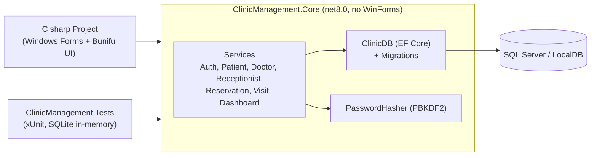

# Clinic Management System (C# Windows Forms)

A desktop application for running a small **clinic**: patients, doctors, receptionists, appointment reservations, and the doctor's diagnosis and prescription for each visit. It's built with **C# Windows Forms (.NET 8)** and **Entity Framework Core (code first) on SQL Server**. It was a team training project.

<!-- TODO(Youssef): confirm which parts you built yourself before adding a "My role" section. -->


## Features by role

The login screen asks for a role:

| Role | Can do |
|---|---|
| **Admin** | Opens the home dashboard (counts of patients, doctors, receptionists and reservations) and from there manages **patients, doctors and receptionists** (add, update, delete, search) |
| **Doctor** | A personal dashboard of today's reservations (waiting / done, % done), and recording a **diagnosis and medicine** for a waiting patient, which marks the reservation Done |
| **Receptionist** | Registers patients and books **reservations** with a doctor (date and time, price, status); a dashboard of all of today's appointments |

## Architecture



* **`C sharp Project.csproj`** (repository root): the forms. They only read input, call a service, and show the result. `Ui.cs` turns errors into friendly messages, asks for confirmation before deletes, and handles navigation between screens.
* **`ClinicManagement.Core`**: the EF Core model (`ClinicDB` and the entities), the migrations, and the business rules. Each service call uses its own short-lived `ClinicDB`. Anything that depends on "today" takes an `IClock`, so tests can control the time.
* **`ClinicManagement.Tests`**: xUnit tests that run the services against a real relational database (SQLite in-memory, with foreign keys enforced). They don't need SQL Server or the UI.

## Data model

| Entity | Main fields |
|---|---|
| `Patient` | Name, gender, date of birth, address, phone |
| `Doctor` | Name, specialisation, experience, contact details, password hash |
| `Reciptionist` | Name, contact details, password hash |
| `ReciptionAddPatientDoc` (reservation) | Patient, doctor, receptionist, appointment, price, state (done / not done) |
| `Doctorspatient` (visit record) | Patient, doctor, diagnosis, medicine |
| `Admin` | User name, password hash |

The table and class names keep the original spelling so existing databases keep working.

## Running it

Requirements: Windows, the .NET 8 SDK, and SQL Server or LocalDB.

```powershell
# 1. Optional: point the app at another server. The default is LocalDB:
#    Server=(localdb)\MSSQLLocalDB;Database=DBClinicalManagement;Trusted_Connection=True;TrustServerCertificate=True
$env:CLINIC_DB_CONNECTION = "Server=.\SQLEXPRESS;Database=DBClinicalManagement;Trusted_Connection=True;TrustServerCertificate=True"

# 2. Create or upgrade the schema with the migrations in ClinicManagement.Core
dotnet tool install --global dotnet-ef
dotnet ef database update --project ClinicManagement.Core --startup-project ClinicManagement.Core

# 3. Run the app
dotnet run --project "C sharp Project.csproj"
```

`dotnet ef` reads the same `CLINIC_DB_CONNECTION` variable, so it updates the database the app will use.

### First run: creating the admin account

The app has no built-in admin account or default password. The first time it starts against a database with no admin, it shows a **first-run setup** window before the login screen. There you choose the admin user name and password (at least 10 characters, with at least one letter and one digit, typed twice). After that, log in with the **Admin** role. Doctors and receptionists are then added by the admin from the Doctors and Receptionist pages.

If the admin password is lost, someone with database access can delete the row from the `Admin` table. The setup window then appears again on the next start.

### Upgrading a database created by the old version

Older instructions told you to run `dotnet ef migrations add Initial` yourself, so an existing database may already have the original tables but not this repository's migration history. **Back up the database first**, then:

1. If the database already has the tables, mark the repository's first migration (`20261110130315_InitialCreate`, the original schema) as applied. Create `__EFMigrationsHistory` if it doesn't exist, remove the row for your locally generated `Initial` migration, and insert `('20261110130315_InitialCreate', '8.0.1')`.
2. Run `dotnet ef database update ...` as above. This applies `HashedPasswordsAndAdminAccount`, which widens the doctor and receptionist password columns from 15 to 256 characters and adds the `Admin` table. Existing rows are kept.
3. Existing plain-text passwords keep working (see below). The old `Admin/…123` logins don't, so the first-run setup will ask for an admin password.

## Tests

```bash
dotnet build ClinicManagement.sln
dotnet test ClinicManagement.sln
```

The tests cover password hashing (round trip, unique salts, case-sensitive check, upgrading legacy plain text), the admin password rules and first-run creation, login rules for each role, adding twice, update or delete with nothing selected, doctor update keeping all fields, reservation validation and status (with a fake clock), dashboard counts including the zero-appointment case, a visit marking the reservation Done, and cascade deletes. GitHub Actions (`.github/workflows/build.yml`) builds the solution and runs the tests on Windows.

The Windows Forms screens themselves have no automated UI tests. They are compiled in CI, and their logic lives in the tested services.

## Security notes

* Passwords are hashed with **PBKDF2-HMAC-SHA256** (`Rfc2898DeriveBytes.Pbkdf2` from .NET, 600,000 iterations, random 16-byte salt per password, constant-time comparison). The stored format is `PBKDF2-SHA256$iterations$salt$hash`. No extra packages are used for this.
* **Legacy plain-text passwords** from the original version still work. The first time someone logs in successfully with one, it is replaced with a hash. The check runs in C#, so it is **case-sensitive**, even though SQL Server's default collation is not.
* Passwords are never shown in the grids or loaded back into the edit form. When you update a doctor or receptionist, leaving the password box empty keeps the current password.
* There are no hard-coded credentials. The connection string comes from `CLINIC_DB_CONNECTION` (or the LocalDB default, which uses Windows authentication).

## Known limitations (training project)

* Any plain-text passwords that nobody has logged in with yet stay in plain text in the database until that user's next login.
* There is one admin account and no screen to change its password (see "First run" for the reset route). Staff passwords can be replaced from the admin's Doctors and Receptionist pages.
* Doctor and receptionist names aren't unique; login checks every account with that name against the password.
* Deleting a patient, doctor or receptionist also deletes their reservations (and visit records). This is the cascade the original schema defined, and the app asks for confirmation first.
* The admin's "Reservation" menu item does nothing. Reservations are managed from the receptionist screens.
* There are no automated UI tests (see Tests). The UI uses the third-party **Bunifu UI WinForms** controls, which target .NET Framework (hence the NU1701 build warnings).

## Tech

C# · Windows Forms · .NET 8 · Entity Framework Core 8 · SQL Server · xUnit · Bunifu UI
